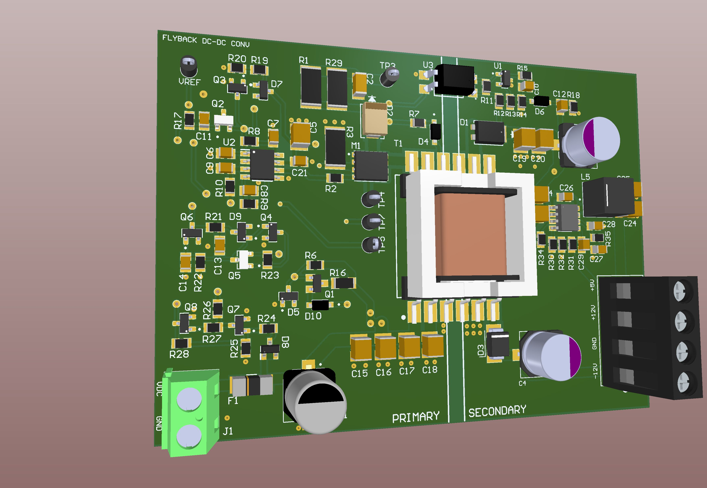
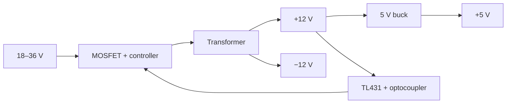
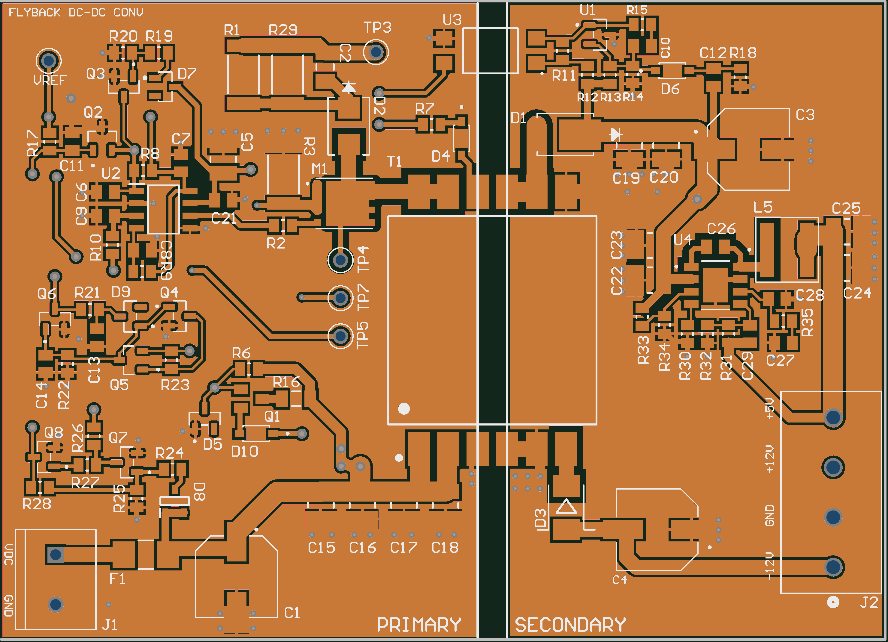
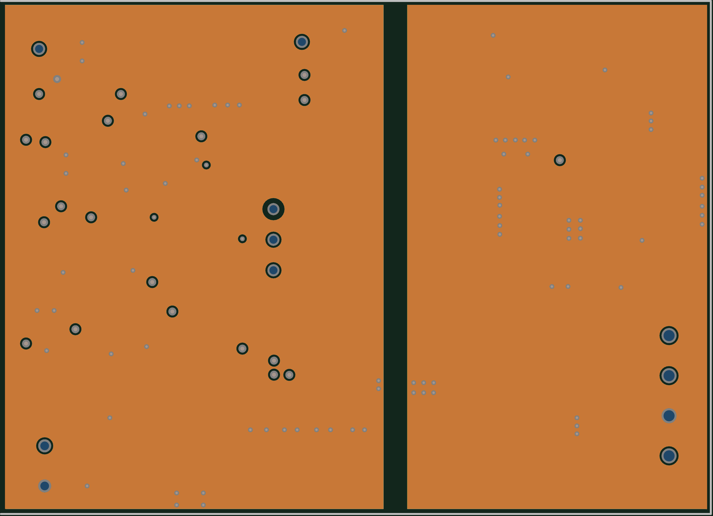
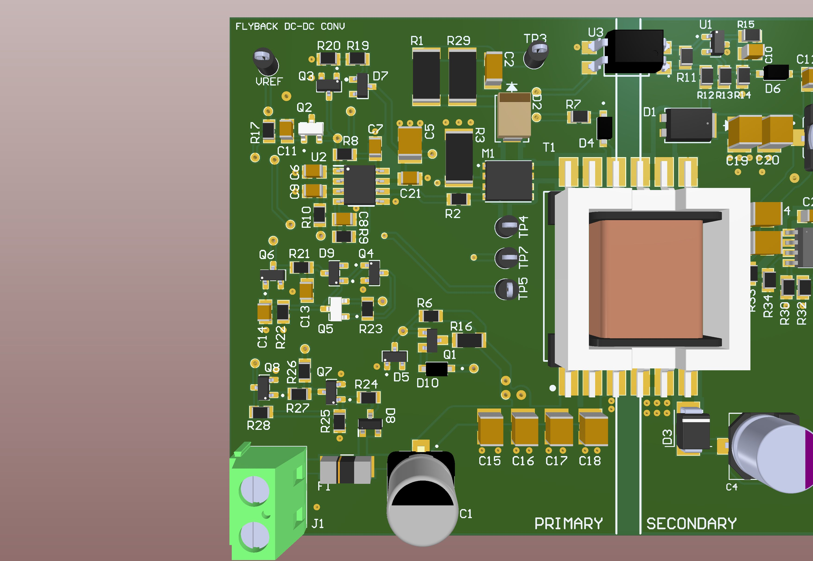
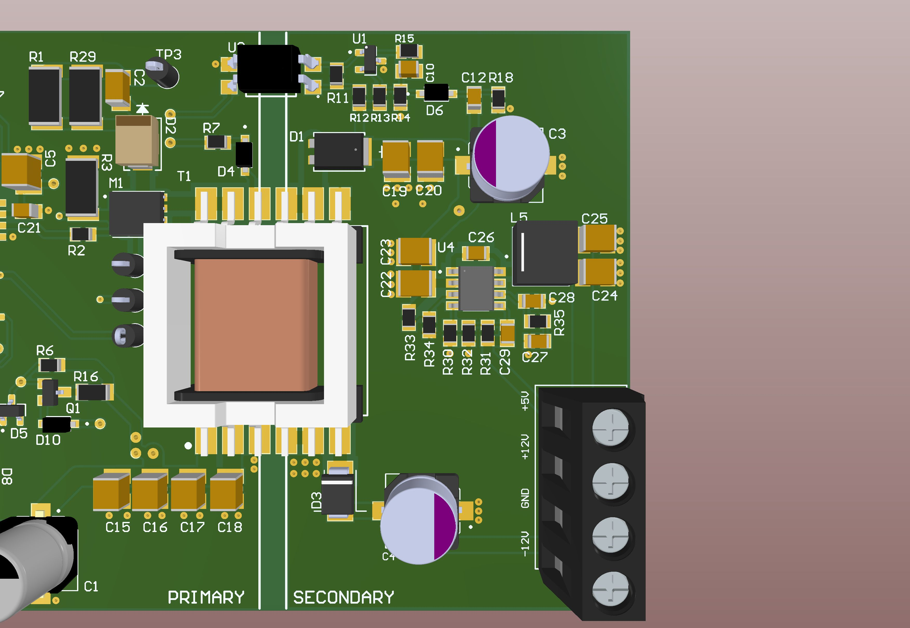
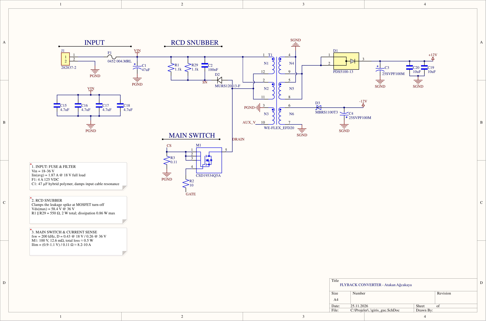
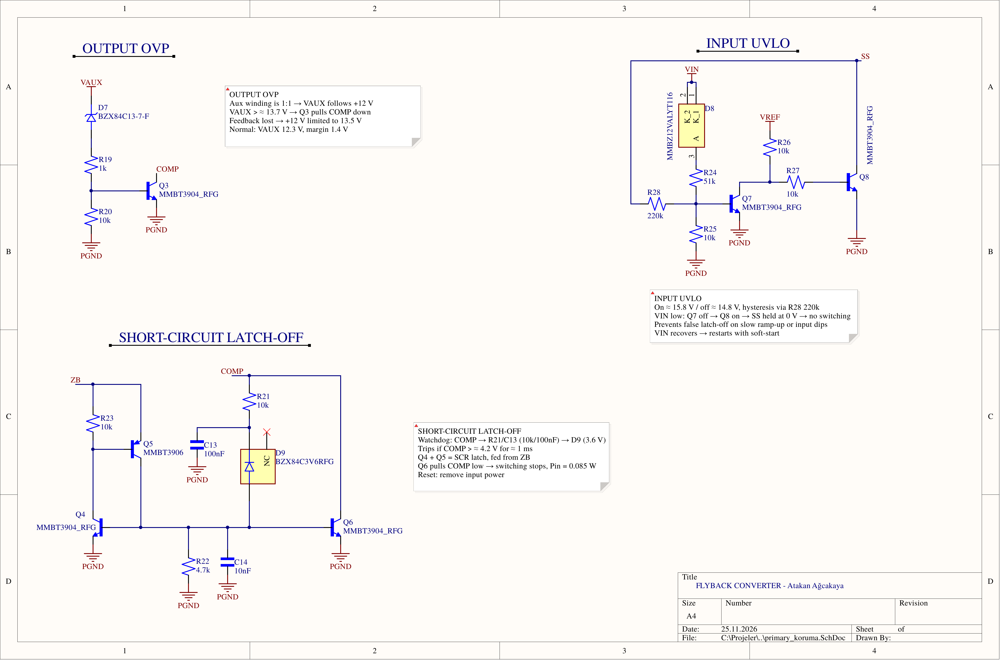
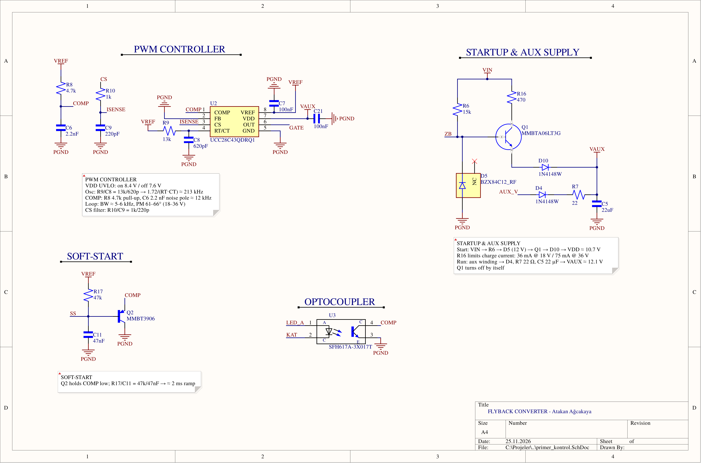
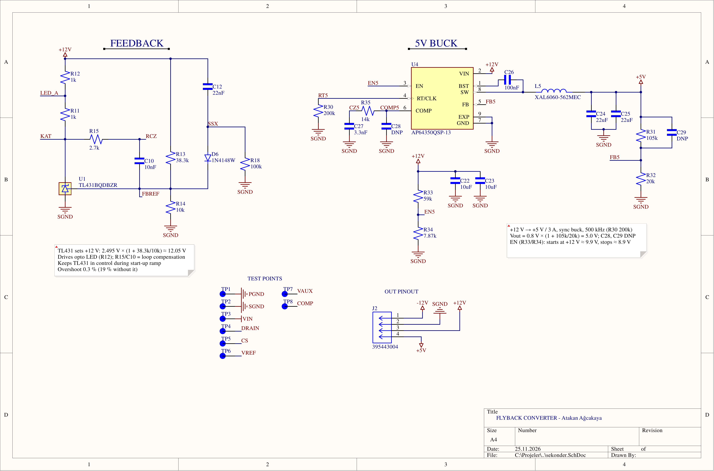

# Flyback DC-DC Converter

  

This is an isolated flyback power supply that takes 18–36 V and gives +12 V, −12 V and +5 V.
I designed it from scratch: requirements, LTspice simulation, part selection, Altium schematic and a 4-layer PCB.

The board has not been built yet. The design is checked in simulation and the PCB passes DRC.

## Specs

| | |
|---|---|
| Input | 18–36 V |
| Outputs | +12 V 0.5 A, −12 V 0.5 A, +5 V 3 A |
| Power | about 27 W |
| Isolation | Input and outputs are galvanically isolated |
| Controller | TI UCC28C43-Q1, around 200 kHz |
| 5 V rail | AP64350Q buck running from +12 V |
| PCB | 4 layers, 90 × 65 mm |
| Tools | Altium Designer, LTspice |

## How It Works

The controller switches the MOSFET and stores energy in the transformer. The secondary windings make +12 V and −12 V.
A TL431 watches +12 V and sends feedback back to the primary side through an optocoupler, so the isolation is kept.
The +5 V rail comes from a small buck converter fed by +12 V.

## Protections

- Input fuse
- Undervoltage lockout: the converter only starts above about 16 V
- Overvoltage protection: if feedback is lost, +12 V is held below 13.5 V
- Short-circuit latch-off: the converter shuts down and stays off until power is cycled
- Cycle-by-cycle current limit
- Soft-start on both sides to avoid overshoot at power-up

## PCB

| Top layer | Ground layer |
|---|---|
|  |  |

- There is a 3 mm gap between the primary and secondary sides on every layer. Only the transformer and the optocoupler cross it.
- The ground layer is split: primary ground on the left, secondary ground on the right. They never touch.
- The switching loops are kept as small as possible to reduce noise.

| Primary side | Secondary side |
|---|---|
|  |  |

## Schematics

| Input and power stage | Protections |
|---|---|
|  |  |

| Controller | Feedback and 5 V buck |
|---|---|
|  |  |

## Simulation

The whole converter was simulated in LTspice: power stage, feedback loop, startup, protections, and the 18 V and 36 V input corners.
The file is in the `simulation` folder.

## Folders

- `hardware` — Altium project, libraries and 3D models
- `simulation` — LTspice file
- `images` — renders, layer images and schematics

## Author

Atakan Ağcakaya